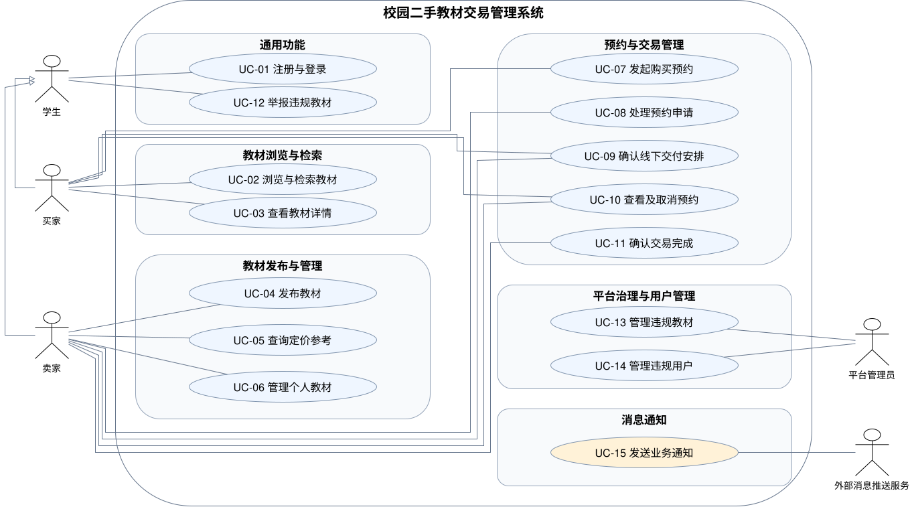

# 校园二手教材交易管理系统
# 软件需求规格说明书（SRS）

| 文档属性 | 内容 |
|---|---|
| 项目名称 | 校园二手教材交易管理系统 |
| 文档版本 | v0.1 |
| 文档状态 | 初稿，待需求评审 |
| 编写依据 | 需求调研报告、问卷统计分析、访谈纪要、用户故事及项目组讨论结果 |

## 1. 引言

### 1.1 编写目的

本文档旨在明确校园二手教材交易管理系统的建设目标、业务范围、用户角色、功能需求、非功能需求及外部接口需求，为后续系统设计、软件开发、测试和项目验收提供统一依据。

本文档基于前期需求调研及用户故事，对用户需求进行归纳和整理，并建立功能需求、系统用例及用户故事之间的对应关系，保证需求的完整性、一致性和可追溯性。

当前版本为需求分析阶段的初稿，相关需求将在项目组讨论及需求评审后进一步完善。

### 1.2 项目背景

高校学生在完成相关课程后，往往存在闲置教材处理需求，而其他学生则希望以较低的价格购买符合课程要求的二手教材。校园二手教材交易能够降低学生的教材购买成本，提高闲置教材的利用率。

根据前期问卷调查及学生访谈，目前校园二手教材交易主要依赖微信群、熟人介绍等分散渠道，存在教材信息查找困难、课程与教材版本匹配不准确、实物状况描述不完整、定价缺少参考以及交易状态更新不及时等问题。

因此，本项目拟开发一个校园二手教材交易管理系统，通过集中化的信息展示、结构化的教材发布及规范的预约交易管理，提高校园二手教材交易的便利性和效率。

### 1.3 项目目标

本项目旨在建立一个面向在校学生的校园二手教材交易管理平台，主要实现以下目标：

- 集中展示校园二手教材信息，降低学生查找教材的时间成本。
- 提供结构化的教材发布、搜索及筛选功能，提高教材信息的完整性和匹配效率。
- 提供教材价格及实物状况参考，辅助学生进行交易决策。
- 建立明确的预约及交易状态管理机制，减少重复预约和交易状态不明确等问题。
- 提供基本的平台管理及业务通知能力，维护正常交易秩序，提高重要信息传递的及时性。

### 1.4 项目范围

本系统采用 Web 应用形式，主要面向在校学生及平台管理员，提供用户注册与登录、教材浏览与检索、教材发布与管理、预约交易、线下交付安排、平台治理及业务通知等功能。

系统负责记录和管理教材交易过程中的相关业务信息，买卖双方在线下自行完成教材交接及付款。

当前版本不包含商家回收、在线支付、资金托管、物流配送、站内私聊及即时通信等功能，也不负责自动核验线下交易结果。

### 1.5 参考资料

本文档主要参考以下资料：

- 校园二手教材交易管理系统需求调研报告。
- 问卷统计分析与调研发现。
- 学生访谈纪要。
- 用户故事及验收标准。
- 项目 GitHub Issues。
- 软件工程课程相关需求分析要求。

## 2. 系统总体描述

### 2.1 系统概述

校园二手教材交易管理系统是一个面向校园内部教材流通场景的 Web 应用系统，以教材发布记录和预约交易记录为核心业务对象，支持教材从发布、检索、预约到交易完成的全过程管理。

学生可以使用同一账号参与教材购买和出售。买家通过浏览、搜索和筛选功能查找目标教材，在查看教材详细信息后提交购买预约；卖家通过教材发布及个人教材管理功能维护闲置教材信息，并处理买家的预约申请。

系统通过统一的教材状态及预约状态管理机制维护交易过程中的业务一致性，同时为管理员提供违规教材处理及用户管理功能。

此外，系统初步计划接入外部消息推送服务，在重要业务状态发生变化时向相关用户发送通知。

### 2.2 用户角色

系统的主要参与者包括学生、买家、卖家、平台管理员及外部消息推送服务。

买家和卖家是学生在不同交易场景中承担的业务角色，并非两种独立的账号类型。同一学生既可以购买其他学生发布的教材，也可以出售自己的闲置教材。

| 参与者 | 主要职责 |
|---|---|
| 学生 | 注册、登录及举报违规教材等通用操作 |
| 买家 | 浏览、搜索、筛选教材，查看详情，提交及管理购买预约 |
| 卖家 | 发布教材、查询定价参考、管理个人教材、处理预约及确认交易完成 |
| 平台管理员 | 处理违规教材及举报信息，管理违规用户 |
| 外部消息推送服务 | 接收系统通知请求并执行消息发送 |

### 2.3 系统功能模块

根据前期需求调研及用户故事，系统主要划分为以下六个功能模块。

| 功能模块 | 主要功能 |
|---|---|
| 用户账号与身份认证 | 注册、登录、退出登录及身份权限验证 |
| 教材浏览与检索 | 教材浏览、关键词搜索、条件筛选、价格比较及详情查看 |
| 教材发布与管理 | 教材发布、信息完善、定价参考、个人教材管理及状态维护 |
| 预约与交易管理 | 预约申请、预约处理、交付安排、预约取消及交易完成确认 |
| 平台治理与用户管理 | 教材举报、违规教材处理及违规用户管理 |
| 消息通知 | 业务通知生成及外部消息推送 |

其中，教材浏览与检索、教材发布与管理以及预约与交易管理构成系统的核心业务功能。用户账号管理为各业务模块提供身份认证及权限控制基础，平台治理和消息通知模块为核心业务提供必要的辅助支持。

### 2.4 核心业务流程

卖家登录系统后，填写教材基本信息及相关补充说明，完成教材发布。发布成功的教材进入在售状态，并展示在平台教材列表中。

买家通过浏览、搜索及筛选功能查找所需教材，查看教材详情后提交购买预约。预约提交后进入待确认状态，由卖家决定是否接受。

在卖家确认预约之前，教材可以接收其他符合条件的预约申请。当卖家接受其中一条预约后，教材进入已预约状态，其余待确认预约自动取消。

预约确认后，买卖双方可以记录并确认线下交付安排，在线下自行完成教材交接及付款。交易完成后，由卖家确认交易结果，系统将预约更新为已完成，并将教材更新为已售出。

若交易过程中发生预约取消，系统应根据当前预约状态同步更新相关教材状态。

系统在预约申请、预约处理、预约取消及交易完成等重要业务事件发生后，向相关用户发送业务通知。

### 2.5 系统用例模型

系统采用 UML 用例图描述各参与者与系统功能之间的关系，明确系统边界及主要业务功能。

买家和卖家通过泛化关系继承学生的通用功能，平台管理员负责平台治理相关操作，外部消息推送服务作为辅助参与者参与业务通知功能。

系统总体用例图如下：

用例图可编辑源文件参见 [Draw.io 用例图](./use-case-diagram.drawio)。

各用例与功能需求、用户故事之间的对应关系见第7章需求追溯矩阵。

## 3. 功能需求

### 3.1 用户账号与身份认证

该模块负责系统用户的身份识别及访问权限管理，为教材发布、预约交易和平台管理等功能提供基础支持。

#### FR-01 注册与登录

系统应支持学生注册、登录及退出登录，并对注册信息的合法性和账号唯一性进行校验。

用户登录时，系统应验证其身份凭据，并在验证成功后允许用户访问权限范围内的功能。

系统应区分普通学生与平台管理员的操作权限，禁止普通学生执行管理员专属操作。具体注册方式及校园身份验证要求待进一步确认。

### 3.2 教材浏览与检索

该模块主要解决校园教材交易信息分散、教材查找困难及版本匹配不准确等问题，为买家提供统一的教材信息获取渠道。

#### FR-02 浏览与检索教材

系统应集中展示符合公开展示条件的教材信息，包括教材名称、版本、价格、成色及交易状态。

买家可以通过关键词搜索查找教材，并根据版本、价格区间、成色、适用课程及专业等信息进行筛选。系统应支持组合筛选及价格排序，帮助买家比较不同教材。

课程、专业等信息为选填项。未填写相应字段的教材不匹配针对该字段设置的筛选条件，但仍可以通过教材名称、版本等其他有效信息进行检索。

系统应在查询无匹配结果时提供明确提示，并允许用户调整查询条件。

#### FR-03 查看教材详情

系统应提供统一的教材详情页面，展示教材名称、版本、价格、成色、交易状态及卖家已填写的作者、出版社、ISBN、适用课程、专业等补充信息。

对于卖家提供的实物照片及笔记、缺页、破损等使用情况说明，系统应在详情页面中进行展示，帮助买家判断教材是否符合购买需求。

当部分选填信息缺失时，系统应正常展示已有信息，并根据教材当前交易状态提供相应的预约入口或状态提示。

### 3.3 教材发布与管理

该模块面向具有闲置教材出售需求的学生，通过结构化的信息发布方式提高教材信息质量，并提供个人教材维护及定价参考功能。

#### FR-04 发布教材

系统应允许已登录且具备发布权限的学生发布闲置教材。

教材发布信息应包括教材名称、版本、价格及成色等基本信息，并允许卖家补充作者、出版社、ISBN、适用课程、专业、实物照片及使用情况说明。

系统应对必填字段及输入内容进行必要校验。教材发布成功后，系统生成独立的教材记录，将其设置为在售状态，并在公开教材列表中展示。

具体必填字段及字段校验规则将在需求评审中进一步确认。

#### FR-05 查询定价参考

系统应允许卖家根据教材名称及版本查询平台中相关在售教材的价格和成色情况，为自主定价提供参考。

当不存在符合条件的参考教材时，系统应提示暂无参考信息，但不影响卖家自主填写价格及发布教材。

系统仅提供已有教材价格信息作为参考，不自动决定教材最终售价。

#### FR-06 管理个人教材

系统应允许卖家集中查看本人发布的教材，并根据教材当前状态执行信息编辑、下架、重新上架及标记售出等操作。

对于存在已确认预约的教材，卖家应先处理当前预约，不得直接执行与当前交易状态冲突的操作。

当教材下架或售出时，系统应同步处理相关待确认预约及教材公开展示状态。卖家不得操作其他学生发布的教材，也不得绕过管理员设置的上架限制。

### 3.4 预约与交易管理

预约与交易管理是本系统的核心业务模块，负责记录买卖双方的购买意向及交易进展，通过统一的状态管理机制减少重复确认及交易信息不明确等问题。

#### FR-07 发起购买预约

系统应允许已登录且具备交易权限的买家对其他学生发布的在售教材提交购买预约。

预约提交成功后，系统生成待确认预约记录，供卖家查看和处理。

系统应检查教材状态及重复预约情况，禁止用户预约本人发布的教材、重复提交有效预约或预约不处于在售状态的教材。

在卖家接受预约之前，教材仍保持在售状态，可以接收其他符合条件的预约申请。

#### FR-08 处理预约申请

系统应允许卖家查看本人教材对应的预约申请，并接受或拒绝待确认预约。

当卖家接受一条预约时，系统应将该预约更新为已确认状态，将教材更新为已预约状态，并取消其他待确认预约。

当卖家拒绝预约时，系统应更新对应预约状态，教材保持原有合法状态。

系统应保证同一本教材同时最多存在一条已确认预约，防止重复确认及状态冲突。

#### FR-09 确认线下交付安排

系统应允许已建立确认预约关系的买卖双方记录线下交付时间及地点，并对交付安排进行确认。

双方均应能够查看当前交付安排及其确认状态。具体交付安排的修改及确认规则待需求评审进一步确定。

本功能仅提供结构化的交付信息记录与确认，不包含站内私聊及即时通信。

#### FR-10 查看及取消预约

系统应允许学生查看本人作为买家或卖家参与的预约记录，包括相关教材、预约状态及已有交付安排等信息。

用户可以根据预约当前状态执行合法的取消操作。取消待确认预约时，教材状态保持不变；取消已确认预约时，系统应解除当前预约关系，并将教材恢复为在售状态。

已结束的预约不得再次取消，用户不得查看或操作无权访问的预约记录。

#### FR-11 确认交易完成

系统应允许卖家在实际线下交易完成后，对对应的已确认预约执行交易完成操作。

交易完成后，系统应将预约更新为已完成状态，将教材更新为已售出状态，并停止该教材的公开展示。

买卖双方仍可通过历史交易记录查看相关信息。系统应防止重复确认及非法状态转换。

### 3.5 平台治理与用户管理

该模块用于维护平台正常交易秩序，通过学生举报和管理员处理相结合的方式，对违规教材及违规用户进行管理。

#### FR-12 举报违规教材

系统应允许已登录学生对涉嫌虚假或违规的教材信息提交举报，并填写相应举报原因。

举报提交成功后，系统生成举报记录，供管理员查看和处理。学生可以查看本人提交的举报及其处理状态。

举报操作本身不直接改变教材交易状态，是否存在违规行为由管理员核实后确定。

#### FR-13 管理违规教材

系统应允许管理员查看教材信息及相关举报记录，并根据核实结果进行处理。

对于确认存在违规行为的教材，管理员可以执行下架操作并记录处理原因。系统应停止该教材的公开展示，处理相关未结束预约，并限制违规教材直接重新上架。

对于未发现违规行为的教材，系统应记录相应举报处理结果，教材状态保持不变。

#### FR-14 管理违规用户

系统应允许管理员查看学生账号的基本信息及账号状态，并根据核实的违规行为执行账号权限限制或解除限制操作。

受限制账号不得发布新教材或建立新的预约交易关系，但应能够按照业务规则处理已有交易。

管理员执行相关操作时，系统应记录处理原因及必要的管理信息。

### 3.6 消息通知

该模块用于提高交易过程中重要业务信息传递的及时性，减少用户因未及时查看系统而错过预约申请及处理结果等信息的情况。

#### FR-15 发送业务通知

系统应在重要业务操作成功后，根据业务事件向相关用户发送通知。

初步确定的通知场景如下：

| 业务事件 | 通知对象 |
|---|---|
| 买家提交预约 | 卖家 |
| 卖家接受或拒绝预约 | 对应买家 |
| 预约被取消 | 受影响的交易参与者 |
| 提交或确认交付安排 | 交易另一方 |
| 卖家确认交易完成 | 买家 |
| 管理员处理违规教材或用户 | 相关学生 |
| 管理员完成举报处理 | 举报人 |

系统负责识别通知事件、确定通知对象及生成通知内容，并通过外部消息推送服务执行消息发送。

当通知发送失败时，不应影响已经成功完成的核心业务操作。具体通知渠道及必须实现的通知场景将在后续评审中确定。

## 4. 非功能需求

### 4.1 NFR-01 性能需求

系统应具备满足校园二手教材交易场景的基本查询性能，能够在一定数据规模及并发访问条件下及时返回正确的教材搜索结果。

初步性能目标为：在包含1000条教材记录、20名用户并发查询的测试环境下，至少95%的教材关键词搜索请求在2秒内成功返回正确结果。

上述指标为初步拟定目标，需结合实际开发及测试环境进一步确认。

验证方式：性能测试。

### 4.2 NFR-02 安全性需求

系统应对受保护的业务操作进行身份认证及权限校验，防止未登录用户或不具备相应权限的用户访问受保护功能。

普通学生不得执行管理员专属操作，用户不得越权修改他人的教材、预约及其他非公开业务记录。

用户密码不得以明文形式存储，系统接口及外部通知内容不得泄露密码、认证凭据等敏感信息。

验证方式：身份认证测试、越权访问测试及敏感信息检查。

### 4.3 NFR-03 可靠性需求

系统应保证教材状态与预约状态之间的一致性。同一本教材同时最多存在一条已确认预约。

在并发预约确认、重复提交或业务操作异常等情况下，系统不得产生重复确认记录、非法状态转换或部分更新的错误业务状态。

验证方式：并发测试、重复请求测试及数据一致性测试。

### 4.4 NFR-04 可用性需求

当后端应用服务发生异常停止时，在数据库及运行环境未受到损坏的前提下，系统应能够通过既定恢复流程重新提供核心业务功能。

故障恢复后，已经成功保存的用户、教材及预约记录应保持完整，相关业务状态应保持一致。

当前版本不要求实现高可用集群或自动故障转移，具体故障恢复时间目标将在需求评审中确定。

验证方式：模拟应用服务异常停止，执行恢复操作并检查核心功能及业务数据。

## 5. 外部接口需求

### 5.1 用户界面需求

系统采用 Web 应用形式提供用户交互界面。普通学生通过教材浏览、教材发布及预约管理等页面完成相关业务操作，管理员通过具有相应访问权限的管理界面完成平台治理工作。

系统界面应清晰展示教材信息、交易状态及当前允许执行的操作，明确区分必填字段与选填字段，并在输入错误、权限不足或业务状态冲突时提供必要提示。

具体页面布局及视觉设计将在后续系统设计阶段确定。

### 5.2 外部消息推送服务

本系统初步选择消息推送服务作为外部集成系统，用于向用户发送预约申请、预约处理结果、预约取消及交易完成等重要业务通知。

本系统负责识别业务事件、确定通知对象及生成通知内容，外部消息推送服务负责接收通知请求并执行消息发送。

外部消息推送服务不直接参与教材状态及预约状态管理，不作为用户之间的自由通信渠道。

具体服务提供方、推送渠道、接口协议及认证方式将在后续系统设计阶段确定。

### 5.3 外部服务异常处理

消息通知属于核心业务的辅助功能。当外部消息推送服务不可用、请求超时或发送失败时，系统应记录相应异常，不应撤销已经成功完成的业务操作。

用户仍应能够通过系统查询最新的教材及预约状态。系统不得将无法确认的消息送达结果标记为已送达。

系统向外部服务提供的信息应限制在完成通知发送所必要的范围内，避免泄露无关个人信息。

## 6. 数据需求与核心业务规则

### 6.1 主要业务数据

系统应对用户、教材、预约、交付安排、举报及通知等业务数据进行统一管理，并保证已经成功保存的业务数据能够在应用服务重启后继续使用。

| 数据对象 | 主要信息 |
|---|---|
| 用户 | 账号信息、身份权限、账号状态及必要通知接收信息 |
| 教材 | 发布者、教材基本信息、价格、成色、补充说明及交易状态 |
| 预约 | 关联教材、买家、卖家、预约状态及相关时间 |
| 交付安排 | 关联预约、交付时间、交付地点及确认状态 |
| 举报 | 举报人、关联教材、举报原因及处理结果 |
| 管理记录 | 处理对象、处理原因、处理人及处理时间 |
| 通知记录 | 通知对象、事件类型及发送处理结果 |

上述内容为业务数据需求，不代表最终数据库表结构。

### 6.2 教材状态

系统通过教材状态反映教材当前的交易可用性及公开展示情况。

| 教材状态 | 状态说明 | 公开展示 | 接受新预约 |
|---|---|---|---|
| 在售 | 已发布，尚未确认购买对象 | 是 | 是 |
| 已预约 | 卖家已接受购买预约 | 是 | 否 |
| 已售出 | 教材交易已完成或卖家自行售出 | 否 | 否 |
| 已下架 | 卖家主动下架或管理员违规下架 | 否 | 否 |

已售出及已下架教材不再公开展示，但授权用户仍可通过个人教材管理或历史交易记录查看相关信息。

### 6.3 预约状态

预约状态用于记录购买申请及其后续交易进展。

| 预约状态 | 状态说明 |
|---|---|
| 待确认 | 买家已提交预约，等待卖家处理 |
| 已确认 | 卖家已接受预约 |
| 已拒绝 | 卖家已拒绝预约 |
| 已取消 | 预约被用户或系统取消 |
| 已完成 | 卖家已确认线下交易完成 |

待确认预约可以进入已确认、已拒绝或已取消状态；已确认预约可以进入已完成或已取消状态。

已拒绝、已取消及已完成属于预约结束状态，不得直接恢复为有效预约。

### 6.4 核心业务规则

为保证各功能模块之间的业务一致性，系统应统一遵循以下规则。

| 编号 | 业务规则 |
|---|---|
| BR-01 | 同一学生可以同时承担买家和卖家角色，但不得预约本人发布的教材。 |
| BR-02 | 同一本在售教材可以存在多个待确认预约，但同时最多存在一条已确认预约。 |
| BR-03 | 同一买家不得对同一本教材重复提交有效预约。 |
| BR-04 | 卖家接受一条预约后，教材变为已预约，其余待确认预约自动取消。 |
| BR-05 | 已确认预约被正常取消后，教材恢复为在售状态，原有已取消预约不自动恢复。 |
| BR-06 | 存在已确认预约的教材不得由卖家直接下架或标记售出。 |
| BR-07 | 教材下架或自行售出时，应同步处理相关未结束预约。 |
| BR-08 | 交易完成后，预约变为已完成，教材变为已售出。 |
| BR-09 | 课程、专业等选填信息缺失时，不影响教材正常发布及其他有效字段的检索。 |
| BR-10 | 管理员违规下架的教材不得绕过管理限制直接重新上架。 |
| BR-11 | 用户不得越权访问或修改其他用户的非公开业务记录。 |
| BR-12 | 外部消息通知发送失败不得撤销已经成功完成的核心业务操作。 |

## 7. 需求追溯与待确认事项

### 7.1 需求追溯矩阵

为保证需求的完整性及可追溯性，系统建立功能需求、用例及用户故事之间的对应关系。

详细用户故事、调研依据及 Given/When/Then 验收标准通过对应的用户故事文档及 GitHub Issues 进行维护。

#### 功能需求追溯

| 需求编号 | 功能需求 | 用例编号 | 用户故事编号 |
|---|---|---|---|
| FR-01 | 注册与登录 | UC-01 | US-16 |
| FR-02 | 浏览与检索教材 | UC-02 | US-01、02、03、05、06 |
| FR-03 | 查看教材详情 | UC-03 | US-04 |
| FR-04 | 发布教材 | UC-04 | US-08、09 |
| FR-05 | 查询定价参考 | UC-05 | US-10 |
| FR-06 | 管理个人教材 | UC-06 | US-11、12 |
| FR-07 | 发起购买预约 | UC-07 | US-07 |
| FR-08 | 处理预约申请 | UC-08 | US-13 |
| FR-09 | 确认线下交付安排 | UC-09 | US-14 |
| FR-10 | 查看及取消预约 | UC-10 | US-15 |
| FR-11 | 确认交易完成 | UC-11 | US-17 |
| FR-12 | 举报违规教材 | UC-12 | US-22 |
| FR-13 | 管理违规教材 | UC-13 | US-18 |
| FR-14 | 管理违规用户 | UC-14 | US-24 |
| FR-15 | 发送业务通知 | UC-15 | US-25（拟新增） |

#### 非功能需求追溯

| 需求编号 | 需求名称 | 用户故事编号 |
|---|---|---|
| NFR-01 | 性能需求 | US-19 |
| NFR-02 | 安全性需求 | US-20 |
| NFR-03 | 可靠性需求 | US-21 |
| NFR-04 | 可用性需求 | US-23 |

后续进入系统设计、开发及测试阶段后，应进一步建立需求与设计模型、开发任务及测试用例之间的对应关系。

### 7.2 待确认事项

当前版本为需求初稿，以下事项需要在需求评审及后续系统设计过程中进一步确认。

| 编号 | 待确认事项 |
|---|---|
| TBD-01 | 用户注册方式及是否需要校园身份验证 |
| TBD-02 | 未登录用户是否允许浏览及搜索公开教材 |
| TBD-03 | 教材发布必填字段及版本不明确时的填写规则 |
| TBD-04 | 线下交付安排的具体提交、修改及确认规则 |
| TBD-05 | 性能验收指标及故障恢复时间目标 |
| TBD-06 | 外部消息推送服务提供方、通知渠道及通知范围 |
| TBD-07 | 违规教材及违规账号的具体处理规则 |

其中，影响系统业务范围及验收标准的事项应优先在需求评审中确认，具体技术实现方案将在后续系统设计阶段确定。

### 7.3 需求变更管理

本需求规格说明书经项目组内部审核及需求评审后，将根据评审结果进行修改和完善，并形成正式需求基线。

后续如需新增、删除或修改需求，应通过 GitHub Issue 记录变更原因及影响范围，经项目组审核后通过 Pull Request 更新相关文档及需求追溯关系。

### 7.4 版本记录

| 版本 | 变更内容 | 状态 |
|---|---|---|
| v0.1 | 基于需求调研及用户故事建立初步需求规格说明，明确系统范围、功能需求、非功能需求、外部系统集成及核心业务规则 | 待评审 |